# Event Storming – System do zarządzania domową spiżarnią

---

## 1. Konteksty

| Kontekst | Odpowiedzialność | Główne agregaty |
|---|---|---|
| **Tożsamość (Identity)** | rejestracja, logowanie, OAuth, role | `UserAccount` |
| **Gospodarstwa (Households)** | gospodarstwa, członkostwa, zaproszenia, miejsca przechowywania | `Household`, `Invitation` |
| **Katalog (Catalog)** | słownik produktów, kategorie, kody EAN, integracja OFF | `ProductDefinition`, `Category` |
| **Spiżarnia (Pantry)** | produkty w domu, ilości, statusy, dziennik zdarzeń | `PantryItem` |
| **Zakupy (Shopping)** | listy zakupów i pozycje | `ShoppingList` |
| **Przypomnienia (Reminders)** | wykrywanie kończących się terminów, powiadomienia | `Notification`, `NotificationPreferences` |
| **Przepisy (Recipes)** | katalog przepisów, dopasowanie do zawartości spiżarni | `Recipe` |
| **Statystyki (Statistics)** | widoki tylko do odczytu na podstawie dziennika zdarzeń | – (read model) |
| **Administracja (Admin)** | zarządzanie użytkownikami, słownikami, logi | – (korzysta z innych kontekstów) |

## 2. Oś czasu – Big Picture

```
Rejestracja → Gospodarstwo → Zaproszenia → [Zakupy] → Produkty w spiżarni → Przypomnienia → Przepisy → Zużycie/Wyrzucenie/Oddanie → Statystyki
                                                ↑______________________________________________________________|
                                                            (produkt zużyty → dodaj do listy zakupów)
```

## 3. Diagram głównych przepływów

```mermaid
flowchart LR
  classDef event fill:#FFA94D,stroke:#C76A00,color:#000
  classDef command fill:#74C0FC,stroke:#1971C2,color:#000
  classDef aggregate fill:#FFE066,stroke:#B08900,color:#000
  classDef policy fill:#D0BFFF,stroke:#6741D9,color:#000
  classDef view fill:#8CE99A,stroke:#2B8A3E,color:#000
  classDef external fill:#FF8787,stroke:#C92A2A,color:#000
  classDef actor fill:#FFF3BF,stroke:#888,color:#000

  U((Członek gospodarstwa)):::actor

  %% Zakupy -> spiżarnia
  C1[Oznacz pozycję jako kupioną]:::command --> A1[ShoppingList]:::aggregate --> E1[Pozycja listy kupiona]:::event
  E1 --> P1{{Polityka: zaproponuj przeniesienie do spiżarni}}:::policy
  P1 --> C2[Przenieś pozycję do spiżarni]:::command --> A2[PantryItem]:::aggregate --> E2[Produkt dodany do spiżarni]:::event

  %% Skan
  U --> C3[Zeskanuj kod kreskowy]:::command --> A3[ProductDefinition]:::aggregate
  A3 -- brak w słowniku --> X1[(Open Food Facts)]:::external
  X1 --> E3[Dane produktu pobrane z bazy zewnętrznej]:::event --> C4[Dodaj produkt do spiżarni]:::command --> A2

  %% Przypomnienia
  T((Zegar / Hangfire 07:00)):::actor --> C5[Skanuj terminy ważności]:::command --> E4[Wykryto produkt z kończącym się terminem]:::event
  E4 --> P2{{Polityka: powiadom członków gospodarstwa}}:::policy --> C6[Utwórz powiadomienie]:::command --> E5[Powiadomienie utworzone]:::event
  E5 --> P3{{Polityka: jeśli e-mail włączony → wyślij podsumowanie}}:::policy --> X2[(Serwer SMTP)]:::external
  E5 --> V1[Widok: Centrum powiadomień / Kończy się termin]:::view

  %% Przepisy
  V1 --> C7[Pokaż propozycje przepisów]:::command --> A4[Recipe]:::aggregate --> E6[Propozycje przepisów wyliczone]:::event

  %% Zamknięcie produktu
  U --> C8[Oznacz jako zużyty / wyrzucony / oddany]:::command --> A2
  A2 --> E7[Produkt zużyty]:::event
  A2 --> E8[Produkt wyrzucony]:::event
  A2 --> E9[Produkt oddany]:::event
  E7 --> P4{{Polityka: jeśli był kończący się → produkt uratowany}}:::policy --> E10[Produkt uratowany]:::event
  E9 --> P4
  E7 & E8 & E9 & E10 --> V2[Widok: Statystyki]:::view
  E7 --> P5{{Polityka: zaproponuj dodanie do listy zakupów}}:::policy --> C1
```



## 4. Zdarzenia (Events) 🟧

### Tożsamość
* Konto użytkownika zarejestrowane
* Adres e-mail potwierdzony
* Użytkownik zalogowany (hasłem / przez Google)
* Konto zewnętrzne (Google) powiązane z kontem
* Token odświeżający unieważniony (wylogowanie)
* Reset hasła zażądany / Hasło zmienione
* Konto usunięte (zanonimizowane)

### Gospodarstwa
* Gospodarstwo utworzone
* Zaproszenie wysłane
* Zaproszenie przyjęte / odrzucone / wygasło
* Członek dołączył do gospodarstwa
* Członek usunięty / opuścił gospodarstwo
* Własność gospodarstwa przekazana
* Miejsce przechowywania dodane / zmienione

### Katalog
* Kod kreskowy zeskanowany
* Definicja produktu znaleziona w słowniku
* Dane produktu pobrane z Open Food Facts
* Kod kreskowy nieznany
* Definicja produktu utworzona (przez użytkownika / admina / z OFF)
* Definicja produktu zmieniona / scalona / usunięta
* Kategoria dodana / zmieniona

### Spiżarnia
* Produkt dodany do spiżarni (= zakup)
* Produkt zmieniony (np. przeniesiony do zamrażarki, zmieniona data)
* Produkt usunięty (pomyłka)
* Produkt (częściowo) zużyty
* Produkt (częściowo) wyrzucony
* Produkt (częściowo) oddany
* Produkt uratowany przed upływem terminu
* Produkt zamknięty (ilość = 0)

### Przypomnienia
* Skan terminów uruchomiony / zakończony
* Wykryto produkt z kończącym się terminem
* Wykryto produkt przeterminowany
* Powiadomienie utworzone
* Powiadomienie przeczytane
* Podsumowanie e-mail wysłane / wysyłka nieudana
* Ustawienia powiadomień zmienione

### Zakupy
* Lista zakupów utworzona / zarchiwizowana
* Pozycja dodana do listy
* Pozycja odhaczona jako kupiona / odznaczona
* Pozycja przeniesiona do spiżarni

### Przepisy
* Propozycje przepisów wyliczone
* Brakujące składniki dodane do listy zakupów

### Administracja
* Użytkownik zablokowany / odblokowany
* Rola administratora nadana / odebrana
* Logi przejrzane (audyt – opcjonalnie)

## 5. Komendy (Commands) 🟦

| Komenda | Aktor | Agregat | Zdarzenie wynikowe |
|---|---|---|---|
| Zarejestruj konto | Gość | UserAccount | Konto użytkownika zarejestrowane |
| Zaloguj przez Google | Gość | UserAccount | Użytkownik zalogowany / Konto zewnętrzne powiązane |
| Potwierdź e-mail | Użytkownik | UserAccount | Adres e-mail potwierdzony |
| Utwórz gospodarstwo | Użytkownik | Household | Gospodarstwo utworzone |
| Zaproś użytkownika | Właściciel | Household / Invitation | Zaproszenie wysłane |
| Przyjmij / odrzuć zaproszenie | Zaproszony | Invitation | Zaproszenie przyjęte / odrzucone |
| Usuń członka / Opuść gospodarstwo | Właściciel / Członek | Household | Członek usunięty / opuścił |
| Zeskanuj kod | Członek | ProductDefinition | Definicja znaleziona / pobrana z OFF / kod nieznany |
| Dodaj produkt do spiżarni | Członek | PantryItem | Produkt dodany do spiżarni |
| Zmień produkt | Członek | PantryItem | Produkt zmieniony |
| Oznacz jako zużyty / wyrzucony / oddany (ilość) | Członek | PantryItem | Produkt (częściowo) zużyty / wyrzucony / oddany |
| Utwórz listę zakupów | Członek | ShoppingList | Lista zakupów utworzona |
| Dodaj pozycję do listy | Członek / polityka | ShoppingList | Pozycja dodana do listy |
| Odhacz pozycję | Członek | ShoppingList | Pozycja odhaczona jako kupiona |
| Przenieś kupione pozycje do spiżarni | Członek | ShoppingList + PantryItem | Pozycja przeniesiona + Produkt dodany |
| Skanuj terminy ważności | System (zegar) | PantryItem (odczyt) | Wykryto produkt z kończącym się terminem |
| Utwórz powiadomienie | System (polityka) | Notification | Powiadomienie utworzone |
| Oznacz powiadomienie jako przeczytane | Użytkownik | Notification | Powiadomienie przeczytane |
| Zmień ustawienia powiadomień | Użytkownik | NotificationPreferences | Ustawienia zmienione |
| Zaproponuj przepisy | Członek | Recipe (odczyt) | Propozycje przepisów wyliczone |
| Zablokuj użytkownika / Nadaj rolę admina | Administrator | UserAccount | Użytkownik zablokowany / Rola nadana |
| Dodaj / zmień / scal definicję produktu | Administrator | ProductDefinition | Definicja utworzona / zmieniona / scalona |

## 6. Agregaty (Aggregates) 🟨

* **UserAccount** – e-mail, hasło (hash), loginy zewnętrzne, role, stan blokady, ustawienia powiadomień. *Niezmienniki:* unikalny e-mail; zablokowany użytkownik nie może się zalogować.
* **Household** – nazwa, członkowie (z rolą Właściciel/Członek), miejsca przechowywania. *Niezmienniki:* zawsze dokładnie jeden właściciel; właściciel nie może opuścić gospodarstwa bez przekazania własności (lub usunięcia gospodarstwa).
* **Invitation** – gospodarstwo, e-mail/kod, data wygaśnięcia, status. *Niezmienniki:* przyjąć można tylko aktywne, niewygasłe zaproszenie; jedno aktywne zaproszenie na e-mail w gospodarstwie.
* **ProductDefinition** – nazwa, kategoria, domyślna jednostka, masa netto, kody EAN, źródło (Użytkownik/Admin/OFF). *Niezmienniki:* kod EAN unikalny i z poprawną sumą kontrolną.
* **PantryItem** – gospodarstwo, definicja, nazwa, kategoria, ilość początkowa i bieżąca, jednostka, data zakupu, data ważności + typ (DMT/termin), miejsce, status, dziennik zdarzeń. *Niezmienniki:* ilość bieżąca ≥ 0; nie można zużyć/wyrzucić więcej, niż jest; produkt zamknięty nie przyjmuje kolejnych zdarzeń.
* **ShoppingList** – gospodarstwo, nazwa, pozycje (nazwa/definicja, ilość, jednostka, kupiona?, przeniesiona?). *Niezmienniki:* pozycję można przenieść do spiżarni tylko raz i tylko gdy jest kupiona.
* **Notification** – odbiorca, gospodarstwo, produkt, typ (kończy się / przeterminowany), data, przeczytane. *Niezmienniki:* jedno powiadomienie danego typu dla produktu i użytkownika na dzień (idempotencja).
* **Recipe** – nazwa, składniki (powiązane z kategorią/definicją), kroki, czas.

## 7. Polityki (Policies) 🟪

* **Gdy** konto zarejestrowane **→** wyślij e-mail z linkiem potwierdzającym.
* **Gdy** użytkownik loguje się przez Google, a istnieje konto z tym samym zweryfikowanym e-mailem **→** powiąż konto zewnętrzne zamiast tworzyć nowe.
* **Gdy** zaproszenie wysłane **→** wyślij e-mail z linkiem (jeśli adresat nie ma konta – link prowadzi do rejestracji z zachowaniem kodu).
* **Gdy** minie 7 dni od wysłania zaproszenia **→** oznacz zaproszenie jako wygasłe.
* **Gdy** pozycja listy odhaczona jako kupiona **→** zaproponuj przeniesienie do spiżarni (UI: „Przenieś kupione do spiżarni”).
* **Gdy** produkt dodany ze skanu, a OFF zwrócił dane **→** zapisz/uzupełnij definicję produktu w słowniku (cache).
* **Codziennie o 7:00** **→** uruchom skan terminów.
* **Gdy** wykryto produkt z kończącym się terminem **→** utwórz powiadomienie dla każdego członka gospodarstwa (wg jego ustawień *N* dni).
* **Gdy** utworzono powiadomienia i użytkownik ma włączony e-mail **→** wyślij jedno dzienne podsumowanie (nie osobny e-mail na produkt).
* **Gdy** produkt zużyty lub oddany, a w chwili zdarzenia był „kończący się” **→** zarejestruj „produkt uratowany”.
* **Gdy** produkt zamknięty (zużyty/wyrzucony) **→** zaproponuj dodanie go do listy zakupów.
* **Gdy** produkt zamknięty **→** oznacz powiązane nieprzeczytane powiadomienia jako nieaktualne.
* **Gdy** użytkownik zablokowany **→** unieważnij jego refresh tokeny.
* **Gdy** członek usunięty z gospodarstwa **→** usuń jego powiadomienia dotyczące tego gospodarstwa.
* **Codziennie o 3:00** **→** usuń logi starsze niż 30 dni.

## 8. Widoki (Read Models) 🟩

* **Panel główny** – liczba produktów, sekcja „Kończy się termin”, przeterminowane, szybkie akcje (skanuj, dodaj, lista zakupów).
* **Spiżarnia** – lista produktów z filtrami (miejsce, kategoria, status terminu) i sortowaniem.
* **Szczegóły produktu** – dane + historia zdarzeń.
* **Centrum powiadomień** – lista + licznik nieprzeczytanych.
* **Listy zakupów** – lista list, szczegóły z pozycjami do odhaczenia.
* **Propozycje przepisów** – ranking z % dopasowania i brakującymi składnikami.
* **Szczegóły przepisu** – składniki posiadane i brakujące, kroki.
* **Statystyki** – najczęściej kupowane, najczęściej wyrzucane, marnowanie per miesiąc (wykres), uratowane.
* **Gospodarstwo** – członkowie, zaproszenia, miejsca przechowywania.
* **Panel administratora** – użytkownicy, słownik produktów, kategorie, logi, zadania w tle.

## 9. Systemy zewnętrzne 🟥

* **Google** (OAuth 2.0 / OpenID Connect) – logowanie/rejestracja.
* **Open Food Facts** – dane produktów po kodzie EAN.
* **Serwer SMTP** (lokalnie Mailpit) – e-maile.
* **Hangfire / zegar systemowy** – wyzwalanie zadań cyklicznych.

## 10. Hot spoty – pytania i problemy

1. Co dokładnie znaczy „uratowany”?
2. Jak sumować marnowanie dla różnych jednostek?
3. Czy produkty bez daty ważności (np. sól) mają brać udział w przypomnieniach?
4. Co z produktami zamrożonymi – czy przeniesienie do zamrażarki zmienia termin?
5. Kto może usuwać produkty i listy – każdy członek czy tylko właściciel?
6. Co gdy użytkownik należący do gospodarstwa usunie konto?
7. Czy zaproszenie może trafić do osoby bez konta?
